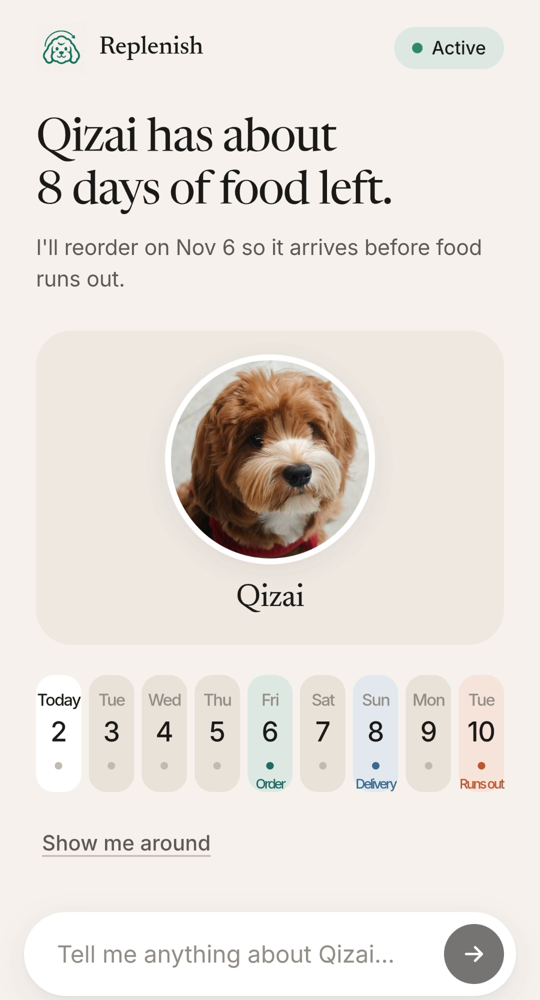
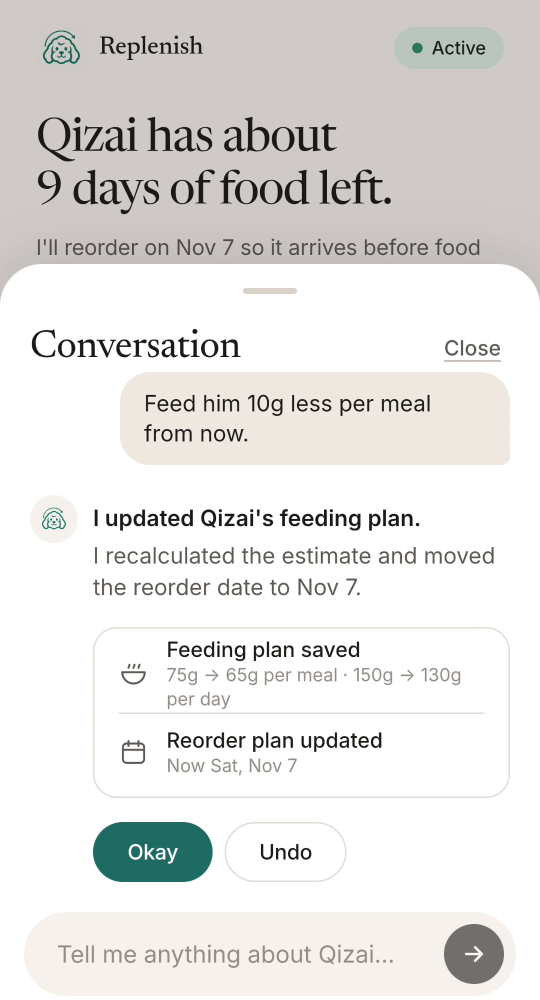
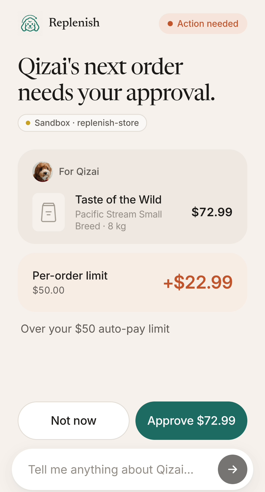
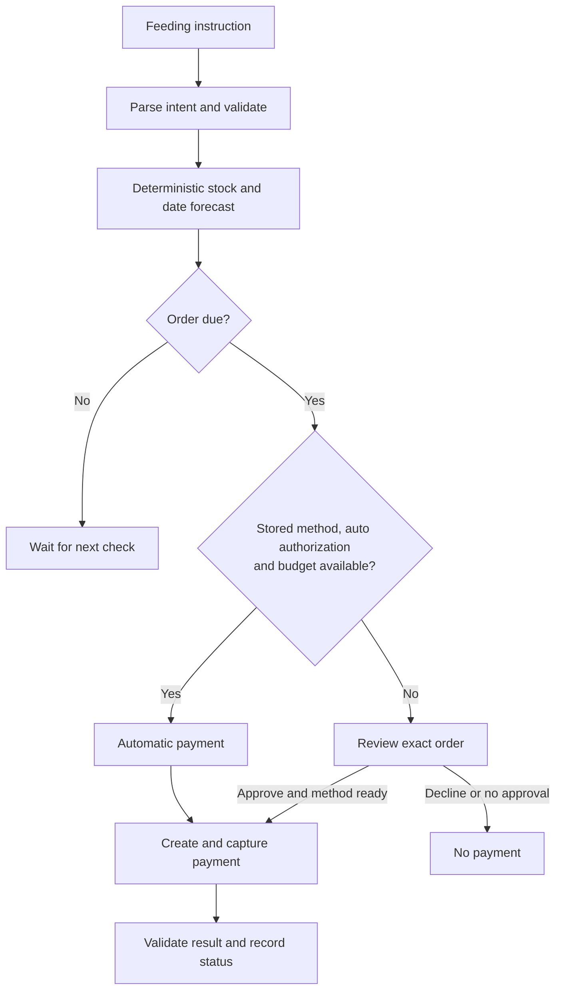
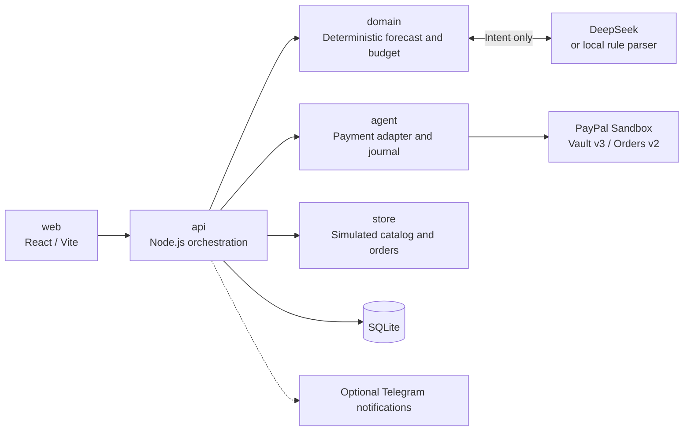

<div align="center">
  
</div>

<p align="center">
  <a href="https://replenish-ai-eze1.onrender.com/">Live demo</a>
  |
  <a href="https://www.youtube.com/watch?v=6BOedfIEZoA">Demo video</a>
</p>

<div align="center">
<table>
  <tr>
    <td valign="top" width="240">
      <strong>Food forecast</strong><br>
      
    </td>
    <td valign="top" width="240">
      <strong>Feeding update</strong><br>
      
    </td>
    <td valign="top" width="240">
      <strong>Order approval</strong><br>
      
    </td>
  </tr>
</table>
</div>

Replenish is an AI-assisted pet-food agent that turns feeding changes into inventory forecasts, replenishment decisions and budget-controlled PayPal Sandbox payments.

Payments use PayPal Sandbox only. The store, stock, and delivery are simulated, and stock is estimated rather than sensor-measured.

These are feature states, not a completed automatic payment. The video shows a completed Sandbox test transaction. The hosted demo is one shared household, so its state can change.

## How it works

From Qizai's two 75g meals per day, send **“Feed him 10g less per meal from now on”**: the saved result is **65g per meal / 130g per day**, with a recalculated forecast and Undo.



The **8kg / $72.99 USD** bag exceeds the default **$50/order** cap; the monthly limit is **$120**, including commitments. A fresh, authorized household with an owner-set **$100/order** cap can take the automatic branch. Approval does not change future limits.

Checks run at startup and every 15 minutes. **Food received** adds the bag once; delivery is simulated. Follow the [repeatable mock walkthrough](docs/demo-runbook.md#repeatable-local-mock-scenario) for both branches.

## Quick start

Requires **Node.js 22.13+ or 24.x**, **pnpm 10.33.4** and a browser. Install Corepack if your Node distribution omits it. Use a fresh shell without exported service settings and fresh local state.

```bash
git clone https://github.com/HanTirong/replenish-ai-hackathon.git
cd replenish-ai-hackathon
corepack pnpm install --frozen-lockfile
cp .env.example .env
corepack pnpm build:web
node --env-file=.env --import tsx packages/api/src/http.ts
```

PowerShell: replace `cp` with `Copy-Item`. Open **http://127.0.0.1:4781**; `/v1/health` returns `{"ok":true}`. No AI key, PayPal credentials or external database are needed.

The template uses `PAYMENT_PROVIDER=mock`. **`pnpm api` does not load `.env`**; the explicit Node command does. Exported variables override the file; `PORT` overrides `API_PORT`. Leave `DATABASE_URL` unset.

Mock startup does not establish a saved payment method or auto-pay authorization; the walkthrough supplies simulated prerequisites. Frontend hot reload and the rest of the setup are in [local development](docs/local-development.md#separate-backend-and-frontend-development).

## Architecture



Package names correspond to `packages/`. AI interprets intent; backend rules validate commands and decide purchases. PayPal credentials never enter the LLM. Stock is estimated, not sensor-measured.

## Tests and verification

```sh
corepack pnpm test
corepack pnpm typecheck
corepack pnpm build:web
```

These checks use simulated services. Browser verification requires Playwright Chromium; see [developer tests](docs/local-development.md#tests-and-browsers).

## Documentation

- [Local development](docs/local-development.md)
- [Sandbox setup](docs/paypal-integration.md)
- [Walkthrough](docs/demo-runbook.md)

[Security](SECURITY.md) · [MIT license](LICENSE) · [Asset/font licenses](THIRD-PARTY-NOTICES.md)
